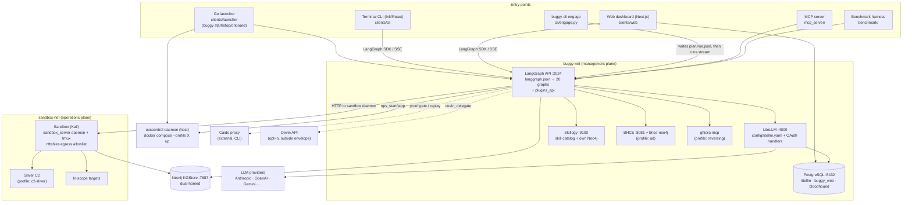
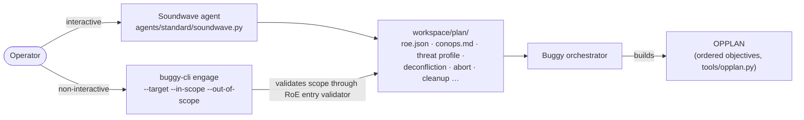
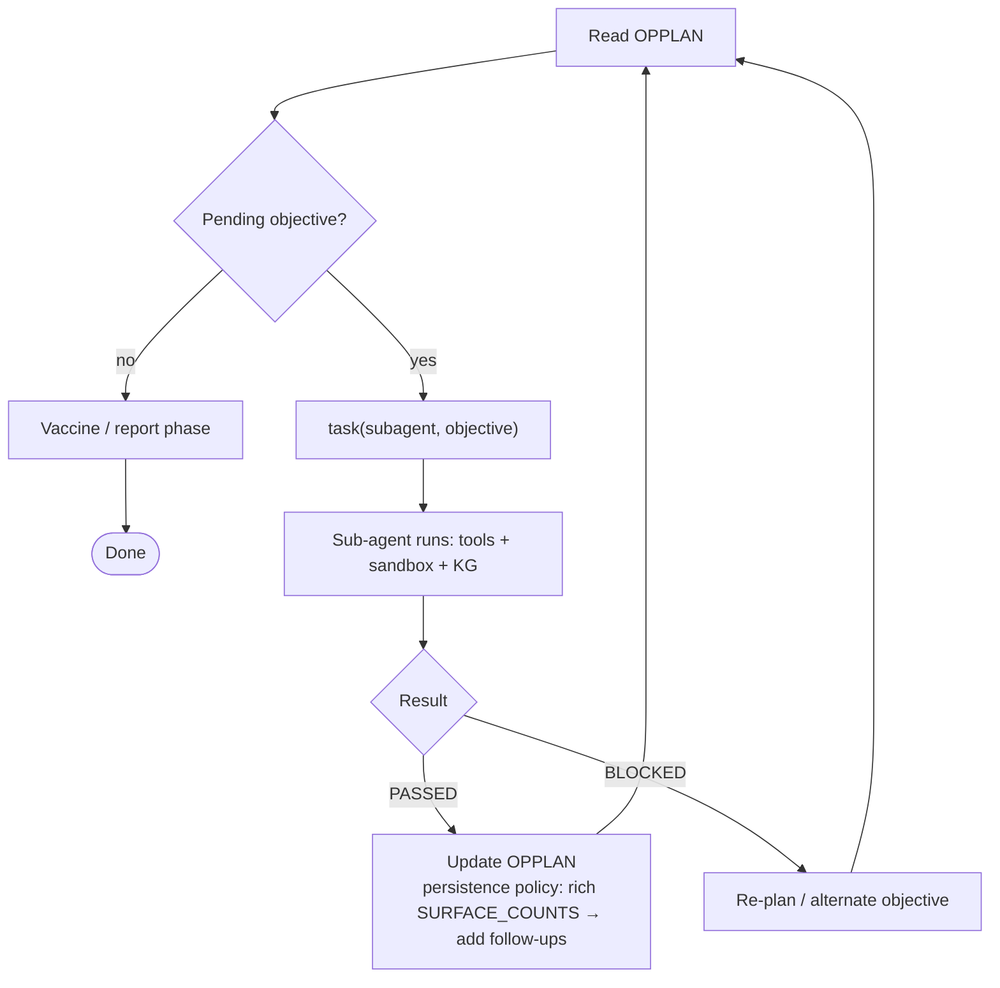
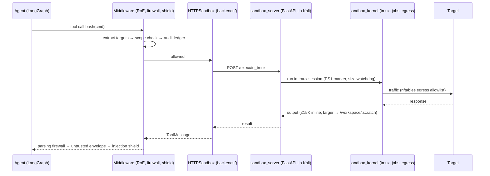
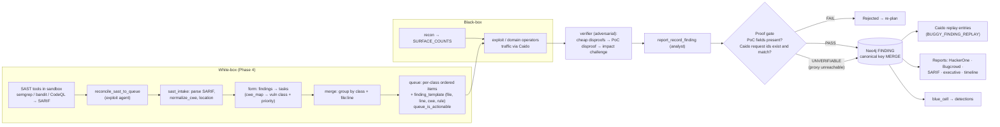
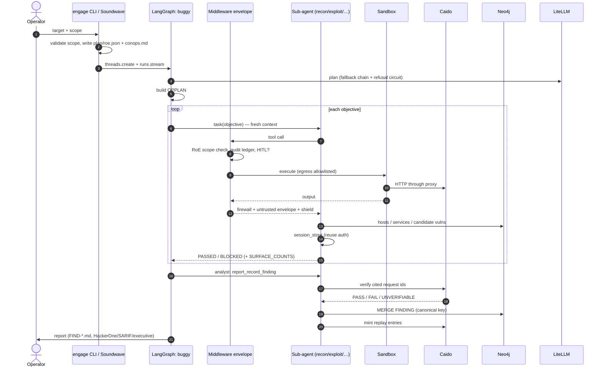

# Buggy — End-to-End Architecture

Buggy is a fork of **Buggy**, an autonomous red-team / bug-hunting agent system. It is built on
LangGraph + deepagents. It runs as a set of Docker services: a **management plane** (LLM gateway,
agent runtime, databases, UI) and an **operations plane** (a Kali sandbox, C2, targets).
LLM agents plan, execute commands in the sandbox, record findings in a knowledge graph, and write reports.

The fork adds six things on top of upstream:

| Phase | Addition | Main code |
|---|---|---|
| 1 | Telemetry / phone-home removed | `telemetry/`, `.env.example` |
| 2 | Parsing firewall (context discipline on tool output) | `middleware/parsing_firewall.py` |
| 3 | Proof gate (a finding needs a PoC plus live Caido evidence) | `tools/reporting/proof_gate.py` |
| 4 | White-box reconciliation (SAST SARIF → exploit queue) | `reconciliation/` |
| 5 | Wiring: recorder on analyst, reconciliation on exploit | `agents/standard/*.py`, `agents/middleware_slots.py` |
| 6 | `engage` CLI, session broker, Devin delegation, KG dedup, refusal circuit, kg_recorder | `cli/engage.py`, `tools/session/`, `tools/devin/`, `llm/factory.py`, `benchmark/kg_recorder.py` |

---

## 1. System map



---

## 2. Deployment: containers and networks

Defined in `docker-compose.yml` (plus `.dev`, `.watch`, `.tun` overlays). Dockerfiles live in `containers/`.

| Service | Network | Purpose | Started |
|---|---|---|---|
| `litellm` | buggy-net | One OpenAI-compatible LLM endpoint for every agent. It handles fallback, spend tracking and OAuth subscription handlers (`config/*_handler.py`). | core |
| `postgres` | buggy-net | LiteLLM keys and spend, web dashboard DB (Prisma), BHCE DB (`containers/postgres-init/`) | core |
| `neo4j` | **both** | The engagement knowledge graph (KGStore). The sandbox writes to it and agents read it. | core |
| `skillogy` | buggy-net | REST skill catalog (`find_skill` / `load_skill` / `traverse`) with a server-side ACL per role | core |
| `langgraph` | buggy-net | Hosts every agent graph (`langgraph.json`) plus `server/plugins_api.py` | core |
| `sandbox` | sandbox-net | Kali image. `sandbox_server` (FastAPI) runs commands in tmux; `sandbox_kernel/egress.py` applies the nftables allowlist. | core |
| `cli` | buggy-net | Ink terminal client | core |
| `web` | buggy-net | Next.js dashboard; port 3000, terminal WebSocket 3003 | on demand (`/web`) |
| `c2-sliver` | sandbox-net | Sliver team server | `ops_start("c2-sliver")` |
| `bhce`, `bhce-neo4j`, `bhce-postgres-init` | buggy-net | BloodHound CE for the AD attack graph | `ops_start("ad")` |
| `ghidra-mcp` | buggy-net | Reverse-engineering backend | `ops_start("reversing")` |

**Network rule:** nothing on `sandbox-net` can reach LiteLLM, Postgres, LangGraph, the web dashboard or BHCE. Neo4j is the only shared service. The real network boundary for attack traffic is the sandbox's nftables egress allowlist.

**Host side:** `clients/launcher` is a Go binary (`buggy start|stop|status|onboard|update|logs`). It drives docker compose and registers the **opscontrol** daemon (`clients/launcher/internal/opscontrol`), which starts and stops specialist profiles when agents ask.

---

## 3. Repository map

```
packages/
  buggy-core/      Pure contracts, no framework deps
    contracts/slots.py    MiddlewareSlot enum (= assembly order), SAFETY_CRITICAL_SLOTS
    protocols/            Agent / Tool / Middleware / Sandbox / LLM / Backend protocols
    registry/             plugin, role, skill, safety and conflict registries
    types/                kg.py (NodeKind/EdgeKind), roe.py, engagement.py, llm.py
    utils/                env.py (env_flag/env_float), normalize.py (host/endpoint), engagement_scope.py
    subscriptions.py      provider-subscription detection (BUGGY_AUTH_*)
  buggy/           The framework
    agents/               build.py, middleware_slots.py, standard/ (20 roles), plugins/ (vulnresearch), bounty/, prompts/
    middleware/           every middleware in the stack (see §6)
    tools/                every agent tool (see §7)
    llm/                  factory.py (model + fallback + refusal circuit), router.py, models.py
    backends/             agent-side sandbox transport (http_sandbox.py, factory.py)
    sandbox_server/       FastAPI daemon that runs INSIDE the sandbox
    sandbox_kernel/       tmux, bounded processes, jobs, egress (nftables), ASVS catalog
    reconciliation/       SARIF → tasks → exploit queue  [fork, Phase 4]
    runtime/              event_log, recording, task_spec, shutdown
    mcp_server/           MCP front-end over LangGraph threads
    server/plugins_api.py extra HTTP routes mounted on LangGraph
    skillogy/             skill-catalog service (builder, server, client, embeddings)
    skills/               SKILL.md tree (standard/, shared/, benchmark/) + .graph/
    blue_cell/            Offensive-Vaccine detection rule matching
    cli/                  python CLI: engage, auth, audit, scan, telemetry, workflows
    telemetry/            OTel config (default off in this fork)
  buggy-sdk/       Plugin SDK (scaffold, examples, testing helpers)
clients/                launcher (Go), cli (Ink), web (Next.js), desktop, shared
config/                 litellm.yaml + provider OAuth handlers
benchmark/              XBOW / Cybench / CyberGym / ExploitBench runners, kg_recorder, kg_seed_learnings
containers/             Dockerfiles + entrypoints
```

---

## 4. Planning layer: how an engagement starts

There are two ways in. Both produce the same **plan bundle** in the engagement workspace.



- **Soundwave** interviews the operator and writes the full 8-document bundle.
- **`engage`** (`cli/engage.py`) skips the interview. It:
  1. writes `plan/roe.json` and `conops.md`;
  2. validates every scope pattern with the guardrail's own validator, so the file is guaranteed to load;
  3. opens a LangGraph thread through `langgraph_sdk` and streams a run of the `buggy` graph.

  With no `--in-scope`, the scope is exactly the given targets.
- **OPPLAN** is the ordered objective list. The orchestrator owns it and updates it through `OPPLANMiddleware` and the `tools/opplan.py` tools.
- **RoE** (`plan/roe.json`) holds scope, forbidden targets and commands, time windows and egress rules. If it is missing, the system runs audit-only, unless `BUGGY_ROE_REQUIRE=1` (then it fails closed).

---

## 5. Agent layer

### 5.1 How an agent is built

`agents/build.py` has one factory path that every role goes through:

```
role name ──► prompt (agents/prompts/builder.py + prompts/standard/<role>.md)
          ──► LLM (llm/factory.py: primary model + fallback list for the role)
          ──► tools (role-specific list, see §7)
          ──► middleware (SLOTS_PER_ROLE[role] → DEFAULT_SLOT_FACTORIES → plugin replacements)
          ──► sandbox backend (backends/factory.py → HTTPSandbox)
          ──► deepagents create_deep_agent(...) → compiled LangGraph graph
```

Plugins (`buggy-sdk`, entry points `buggy.subagents`, `buggy.skills`, …) can add agents, tools, skills and middleware. **Safety-critical** slots can only be replaced when `BUGGY_ALLOW_SAFETY_OVERRIDES=1` is set. Those slots are engagement-context, RoE guardrail, untrusted-output and the injection shield.

### 5.2 Roles

| Group | Agents | Role |
|---|---|---|
| Planner | `soundwave` | Interview, plan bundle |
| Orchestrator | `buggy` | Reads OPPLAN and dispatches sub-agents through `task()`. Holds ops, session and Devin tools. It does no hands-on work itself. |
| Kill chain | `recon` → `exploit` → `postexploit`, `analyst`, `reverser` | `recon` always goes first and emits `SURFACE_COUNTS`. `exploit` holds the reconciliation tools. `analyst` holds the proof-gated recorder. |
| Domain operators | `ad_operator`, `cloud_hunter`, `contract_auditor`, `phisher`, `mobile_operator`, `wireless_operator`, `osint_operator`, `iot_operator`, `ics_operator`, `forensicator`, `supply_chain_operator`, `asvs_assessor` | Specialist work; some ask opscontrol for sidecars |
| Vulnresearch (plugin) | `scanner` → `detector` → `verifier` → `patcher` → `exploiter` (`agents/plugins/`) | 5-stage pipeline. State passes **only** through the KG. The verifier is adversarial and tries to disprove each claim. |
| Bug bounty | `agents/bounty/*` (api_security, ssrf_cloud, authn_session, graphql, llm_security, …) | Bounty-class hunters |
| Defense | `blue_cell`, `retrospective` | Offensive Vaccine: attack path → detection rule; post-run learnings |

Sub-agents start with a **fresh context per objective**. Anything durable goes to `workspace/` and Neo4j, never agent memory.

### 5.3 Orchestration loop



---

## 6. Middleware stack

Every model and tool call passes through an ordered list of middleware. The order is the
declaration order of `MiddlewareSlot` (`buggy-core/contracts/slots.py`). Each role turns slots on or off through
`SLOTS_PER_ROLE`. **Bold** means safety-critical.

| # | Slot | Implementation | What it does |
|---|---|---|---|
| 1 | **engagement-context** | `middleware/engagement.py` | Injects engagement, RoE and scope into every call |
| 2 | **roe-guardrail** | `middleware/roe.py`, `_command_targets.py`, `_audit_sink.py` | Pulls targets from each tool call, then checks scope, forbidden targets and commands, and time windows. Appends to the HMAC-chained `audit/roe-decisions.jsonl`. |
| 3 | hitl-approval | `middleware/hitl.py` | Operator approval for high-impact actions (opt-in, `BUGGY_HITL__ENABLED`) |
| 4 | parsing-firewall | `middleware/parsing_firewall.py` *(fork)* | Trims and structures large tool output before it reaches the model |
| 5 | **untrusted-output** | `middleware/untrusted_output.py` | Wraps tool output in an untrusted envelope |
| 6 | **prompt-injection-shield** | `middleware/prompt_injection_shield.py`, `_injection_detector.py` | Detects and quarantines injection attempts in tool output |
| 7 | skills | `middleware/skills.py`, `skillogy.py` | Skill discovery and loading through Skillogy, with a path-prefix ACL per role |
| 8 | filesystem | `middleware/filesystem.py` | Workspace read/write tools |
| 9 | subagent | deepagents `SubAgentMiddleware` | `task()` tool. Skipped when the roster is empty (Phase 5 fix). |
| 10 | opplan | `middleware/opplan.py` | OPPLAN state injection and persistence |
| 11 | kg | `middleware/kg.py`, `kg_internal/` | KG tools and ingest (skipped if the Neo4j env vars are missing) |
| 12 | event-log | `middleware/event_logging.py` → `runtime/event_log.py` | Append-only event log for each engagement |
| 13 | sandbox-notification | `middleware/notifications.py` | Injects background-command completions as `<system-reminder>` |
| 14 | opscontrol-notification | `middleware/opscontrol_notifications.py` | Injects workload state changes (e.g. "BHCE is up") |
| 15 | budget | `middleware/budget.py` | Token and cost budget per run |
| 16 | model-override | `middleware/model_override.py` | Runtime `/model` switch |
| 17 | model-fallback | langchain `ModelFallbackMiddleware` | Ordered fallback model list for the role |
| 18 | proxy-key-override | `middleware/proxy_key_override.py` | Per-run LiteLLM key |
| 19 | summarization | deepagents | Compacts context when it grows long |
| 20 | prompt-caching | `AnthropicPromptCachingMiddleware` | Cache breakpoints |
| 21 | patch-tool-calls | deepagents | Repairs dangling tool calls |

Middleware from plugins is appended after slot 21.

---

## 7. Tool layer (`packages/buggy/buggy/tools/`)

| Package | Tools / purpose | Talks to |
|---|---|---|
| `bash/` | `bash`, background jobs, tmux sessions, interactive prompts | Sandbox daemon |
| `filesystem.py` | workspace file I/O | `/workspace` bind mount |
| `network/`, `web/`, `browser/` | scanners, HTTP, JWT, OAuth, GraphQL, browser automation | Targets via the sandbox |
| `proxy/` | Caido proxy (history, replay); `CaidoError(kind, exit_code)` | `caido` CLI |
| `reporting/` | `report_record_finding` (**proof gate**), CVSS, HackerOne, Bugcrowd, SARIF, executive and timeline renderers, `kg_adapter` | Caido, Neo4j, workspace |
| `research/` | CVE lookup, SAST orchestration, SARIF, taint, secrets, SCA, IaC, fuzzing, chain planning, dedupe, bounty scope | NVD/OSV/EPSS, Neo4j |
| `ad/` | BHCE client (HMAC), ADCS, delegation, GPO and shadow-cred audits | BHCE |
| `cloud/`, `contracts/`, `reversing/` | cloud, smart-contract and RE tooling | ghidra-mcp etc. |
| `ops/` | `ops_start/ops_stop/ops_status` (orchestrator only) | opscontrol daemon |
| `session/` *(fork)* | `session_store/get/list/clear` over `workspace/sessions/<host>.json`, so auth material is reused rather than re-fought | workspace |
| `devin/` *(fork)* | `devin_delegate` (opt-in). **Outside the enforcement envelope**: no RoE, egress, proof gate or audit. | Devin API |
| `evidence/` | asciicast recordings | workspace |
| `references/` | killchain, methodology, payload and one-liner corpora | local data |
| `skills.py`, `skills_registry.py` | skill tooling | Skillogy |
| `opplan.py` | OPPLAN CRUD | state |
| `mcp/` | MCP client tools | external MCP servers |

---

## 8. Sandbox execution path



Long-running commands use `run_in_background=True`. When they finish, `SandboxNotificationMiddleware` polls
`/read_session_log_diff` and pushes the result to the agent on its next turn.

---

## 9. Model layer

```
agent role ──► llm/factory.py
                 ├─ subscriptions.py: detect which providers have creds (BUGGY_AUTH_*)
                 ├─ primary model for the role + ordered fallback list (llm/models.py, router.py)
                 ├─ refusal circuit [fork]: content_filter → trips at once;
                 │   empty response → trips after 2 in a row → model blacklisted for 900 s
                 └─ ChatOpenAI-style client ──► LiteLLM :4000 ──► provider
                                                   └─ config/*_handler.py for OAuth subscriptions
                                                      (Claude Code, Codex/ChatGPT, Copilot, Gemini, Grok, Perplexity)
```

The model actually served is logged for audit. The removed `claude4_compat` evasion layer is no longer in the prompt builder.

---

## 10. Knowledge and state

| Store | What lives there | Written by | Read by |
|---|---|---|---|
| **Neo4j KGStore** | `Host`, `Service`, `Vulnerability`, `Finding`, `Credential`, `Technique`, `AttackPath`; edges `EXPLOITS`, `REQUIRES`, `AFFECTS`, `LEADS_TO` (`buggy_core/types/kg.py`) | KG middleware and tools, the proof gate (`kg_adapter.publish_finding_node` with a canonical-key MERGE), the sandbox, `kg_recorder` | `kg_query` (findings ranked passes-first, errors in a separate field), the chain planner, vulnresearch stages, blue_cell |
| **Skillogy Neo4j** | `:Skill` graph built from `skills/**/SKILL.md` | Skillogy builder at startup | `SkillogyMiddleware` |
| **BHCE** | AD graph from SharpHound ZIPs | `bhce_ingest_zip` | `bhce_cypher` |
| **PostgreSQL** | LiteLLM spend and keys, dashboard data, BHCE DB | LiteLLM, web, BHCE | same |
| **LangGraph checkpoints** | thread state | LangGraph | LangGraph |
| **workspace/** (per engagement) | `plan/` (roe.json, conops, OPPLAN), `FIND-*.md`, PoCs, `sessions/<host>.json`, `audit/roe-decisions.jsonl`, event log, `.scratch/` | agents, middleware | agents, reports, operator |

---

## 11. Finding pipeline (the fork's core addition)



Proof gate outcomes (`tools/reporting/proof_gate.py`):

- **PASS**: every cited `http_exchange_id` exists in Caido and holds a real request. The finding is persisted with `live_verified=True`.
- **FAIL**: a cited id is missing or doesn't match, or a required PoC field is empty. The finding is rejected.
- **UNVERIFIABLE**: the Caido CLI is missing, timed out, or no client is configured. The finding is persisted with `evidence_unverified=True` and a warning. See the review note in §14.

---

## 12. Dynamic workloads (opscontrol)

```
orchestrator ──ops_start("ad")──► opscontrol daemon (host, systemd/launchd)
                                     └─ docker compose --profile ad up -d   (state: starting → running → stopped)
OpsControlNotificationMiddleware polls /v1/profiles each turn → <system-reminder> on state change
```

The allowed workloads are `ad`, `c2-sliver`, `c2-havoc`, `reversing`, `cloud`, `mobile`, `phishing`, `forensics`, `ics`, `iot`, `supply-chain` and `wireless`.

---

## 13. End-to-end sequence (one engagement)



The benchmark mode (`BENCHMARK_MODE`, `benchmark/harness.py`) follows the same path. The harness spins up
the XBOW or CTF challenge containers, sends each challenge to the orchestrator and checks the flag. It then
records the outcome and learnings to Neo4j through `kg_recorder` (off the event loop, with writes serialized by a lock).

---

## 14. Enforcement envelope and known gaps

**What is enforced**

| Boundary | Mechanism |
|---|---|
| Scope | RoE guardrail on every tool call, plus the sandbox nftables egress allowlist (the authoritative layer) |
| Accountability | HMAC-chained `audit/roe-decisions.jsonl` |
| Prompt injection | untrusted-output envelope + injection shield (safety-critical, locked) |
| Credentials | provider keys live only on buggy-net; the sandbox never sees them |
| Infra | the sandbox cannot route to the management plane |

**Known gaps from the code review**

- **Proof gate fails open.** No container installs the `caido` CLI, so every check ends UNVERIFIABLE and findings are accepted. Report renderers ignore `evidence_unverified`.
- **Proof gate checks existence, not content.** Any real Caido request id passes, even one unrelated to the finding's target.
- **SARIF CWE parsing.** `normalize_cwe` rejects Semgrep (`"CWE-89: …"`) and CodeQL (`"external/cwe/cwe-089"`) tags, so the reconciliation queue stays empty on real tool output.
- **Reconciliation is never prompted.** No prompt tells the exploit agent to call `reconcile_sast_to_queue`, and `queue_is_actionable` is advisory only.
- **KG dedup is weak.** The canonical key never gets a vuln class from the recorder. `normalize_host` splits on `@` before the path. An empty target merges every finding with the same title.
- **Devin delegation** runs completely outside the envelope.
